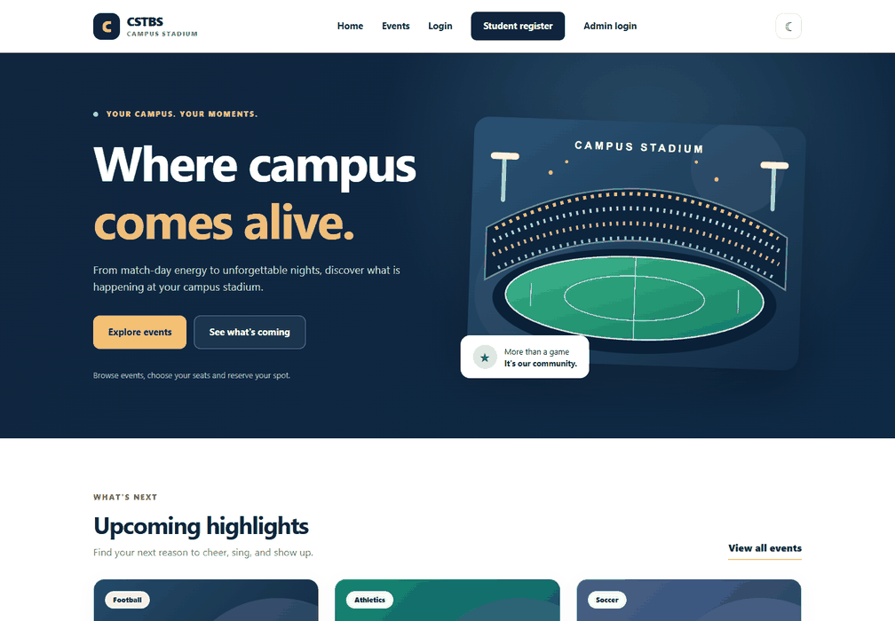
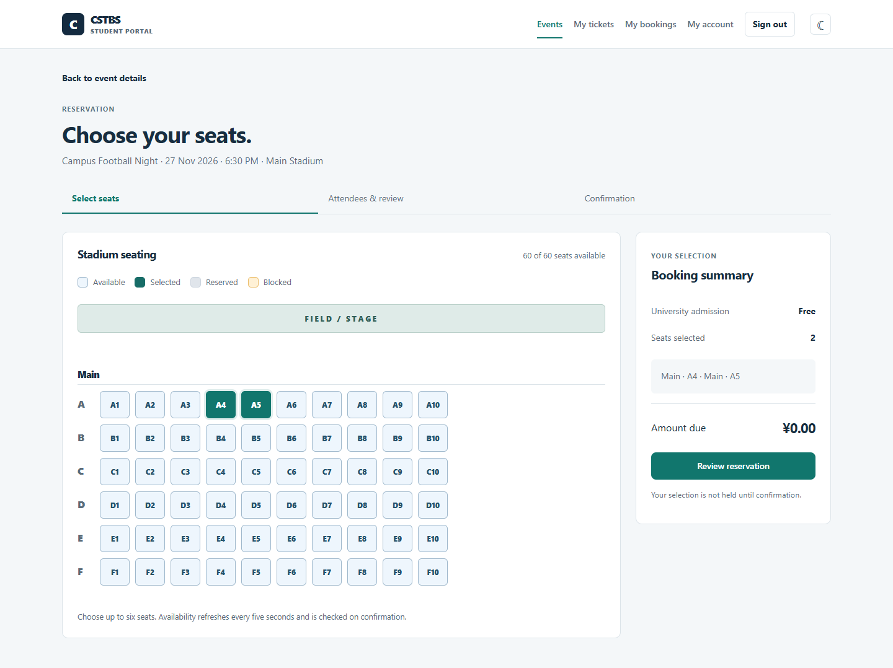
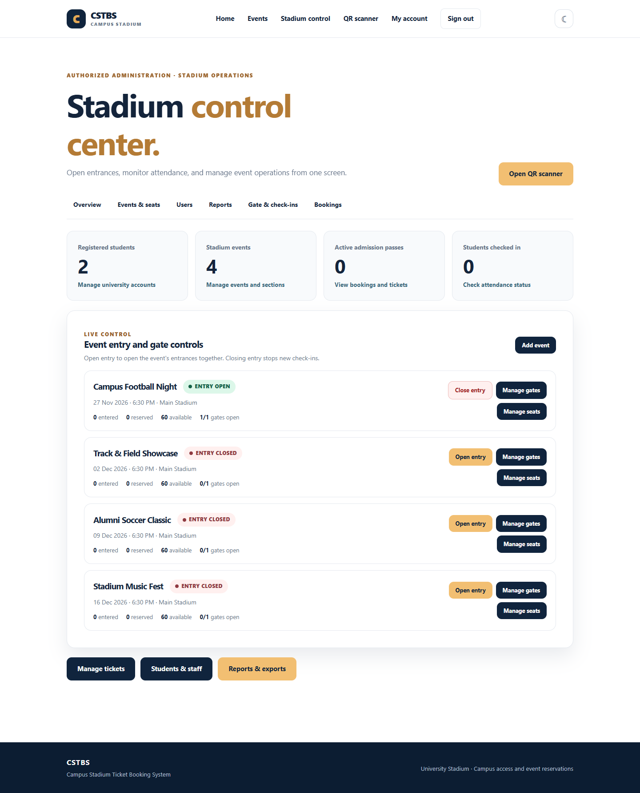

<div align="center">

# CSTBS PHP

**Campus events, assigned seats, and verified stadium admission.**

The PHP and MariaDB edition of the Campus Stadium Ticket Booking System, designed for Apache in XAMPP.

[](https://github.com/MeazbahMehedi/CSTBS-PHP/actions) [](https://www.php.net/) [](LICENSE)

[Install with XAMPP](#install-with-xampp) · [Features](#features) · [Testing](#testing) · [Operations](docs/OPERATIONS.md)



</div>

## Overview

Students discover campus events, reserve free seats for themselves and registered classmates, and receive individual signed QR passes. Staff verify university IDs and confirm admission at the assigned gate. Administrators manage events, seating, accounts, gate operations, attendance, and reports.

This edition uses native PHP views, PDO prepared statements, InnoDB transactions, and MariaDB constraints. Students, administrators, and gate staff have separate workspaces, with a compact responsive interface, light and dark themes, and keyboard-accessible controls. Small transitions respect reduced-motion preferences.

## Features

| Area | Capabilities |
| --- | --- |
| Accounts | Student registration and unique Student IDs, password login, session revocation, and role permissions |
| Administration | First administrator provisioning through a local command, expiring single-use activation keys, and explicit password recovery |
| Reservations | Up to six seats per booking, registered classmate matching, atomic confirmation, and current availability polling |
| Ticket integrity | Unique active seats, one live ticket per student and event, HMAC-signed tokens, and cancelled-ticket invalidation |
| Admission | Gate selection, closed/wrong-gate verdicts, staff-only confirmation, recorded time/gate/officer, and duplicate-entry prevention |
| QR tools | Private SVG QR images, PDF admission passes, compatible-browser camera scanning, manual codes, and server-side QR-photo decoding |
| Stadium controls | Events, sections, seat blocking, gate names and assignments, and individual or event-wide entry controls |
| Reports | Filtered booking reports, attendance views, private PDF exports, and CSV formula protection |
| Operations | Transactional email outbox, SMTP worker, consistent SQL backups, sample events, and opt-in fictional demo accounts |

Admission is free throughout the application.

## Screenshots

Screenshots show the running PHP application with fictional local demonstration accounts.

| Student seat selection | Administrator operations |
| --- | --- |
| [](docs/images/seat-selection.png) | [](docs/images/stadium-control.png) |

[View the homepage](docs/images/home.png)

## Install with XAMPP

### Requirements

- XAMPP with Apache, PHP 8.2 or newer, and MariaDB 10.4 or newer.
- Composer 2 and Git, or a downloaded source archive.
- PHP extensions `pdo_mysql`, `mbstring`, `gd`, `dom`, `xml`, `fileinfo`, and `zip`. Enable GD and ZIP in `C:\xampp\php\php.ini` if necessary, then restart Apache.

### Set up the application

1. Start **Apache** and **MySQL** in XAMPP Control Panel. The MySQL button starts XAMPP's MariaDB service.
2. Open PowerShell and run the following commands.

```powershell
cd C:\xampp\htdocs
git clone https://github.com/MeazbahMehedi/CSTBS-PHP.git
cd CSTBS-PHP
C:\xampp\php\php.exe C:\path\to\composer.phar install --no-dev
Copy-Item config.example.php config.local.php
```

If Composer is installed globally, use `composer install --no-dev` in place of the Composer PHAR command.

3. Edit the private `config.local.php` database settings. Use a dedicated database such as `cstbs_php`. The default base path is `/CSTBS-PHP`. Set `secret` to a persistent random value generated with the following command.

```powershell
C:\xampp\php\php.exe -r "echo bin2hex(random_bytes(32)), PHP_EOL;"
```

The development default database account is `root` with an empty password, matching a fresh local XAMPP installation. Configure the credentials used by your installation. Use a dedicated restricted account for hosting.

4. Install the schema, add sample events, and create the first administrator.

```powershell
C:\xampp\php\php.exe bin\console.php install
C:\xampp\php\php.exe bin\console.php seed-events
C:\xampp\php\php.exe bin\console.php admin-setup admin@campus.edu "University Administrator"
```

`install` can also create `config.local.php` with a random secret when that file is absent. Review the database settings before installation.

5. Open **http://localhost/CSTBS-PHP/**. For the administrator, visit `/CSTBS-PHP/admin/activate` and use the displayed 20-minute key to set a password. Future administrator logins use `/CSTBS-PHP/admin/login`.

Apache must have `mod_rewrite` enabled and permit the supplied `.htaccess` rules. The rules route application URLs and protect private code, configuration, dependencies, and storage.

Once installed, ordinary use requires starting Apache and MySQL in XAMPP. The PHP application runs inside Apache.

## Main workflows

- Students register at `/register`, select an event and up to six seats, verify every attendee, and confirm the booking.
- Each attendee sees their own active passes at `/dashboard`, including tickets arranged by a classmate. The booker can view their reservation history at `/bookings`.
- Administrators open `/admin`, configure gates and sections, and open entry. Newly created gates start closed.
- Staff sign in at `/login`, choose a gate at `/entry/scan`, verify a QR and university ID, and confirm entry.
- Student pages are restricted to students. Administrators and gate staff use their own workspaces, with permissions checked on the server.
- Confirming entry records the campus-local display time, physical gate, and admitting officer. Later scans show **Ticket already used** with these details. Simultaneous attempts admit only once.
- Administrators can delete events from the calendar. Deletion closes gates, cancels unused reservations and passes, and preserves booking and admission history under **Deleted events**. Sections containing booking history remain protected.

All routes above are relative to the configured base path. Live camera access requires HTTPS or localhost, user permission, and browser decoding support. QR-photo upload provides an additional decoding path.

## Security

Passwords use Argon2id where available. A marked SHA-384 prehash with bcrypt supports PHP builds without Argon2id while preserving the full password input. State-changing forms require CSRF tokens, sessions rotate on login, and role or administrator credential changes revoke existing sessions.

Event-scoped locks serialize conflicting operations. Generated-column unique indexes enforce active seat and attendee uniqueness in MariaDB. Prepared queries and escaped templates protect database and HTML boundaries. QR uploads have file-type, byte-size, and pixel-count limits.

Use HTTPS, persistent private secrets, SMTP, a restricted database user, private backups, and a reviewed hosting configuration for a public deployment. See [SECURITY.md](SECURITY.md) and the [operations guide](docs/OPERATIONS.md).

## Testing

```powershell
composer install
C:\xampp\php\php.exe tests\integration.php
```

The test runner creates a uniquely named temporary database and removes that database afterward. Its configured database user needs permission to create and drop test databases. The suite exercises real HTTP requests, independent browser sessions, role isolation, database upgrades, MariaDB constraints, group-booking rollback, stale booking conflicts, simultaneous one-time admission, event deletion with audit preservation, QR-photo decoding, reports, and administrator session revocation.

GitHub Actions runs the suite on PHP 8.2, 8.3, 8.4, and 8.5 with MariaDB 10.11. It also validates Composer, audits locked dependencies, and checks PHP and JavaScript syntax.

The implementation has also been exercised through XAMPP's Apache with a `/CSTBS-PHP` subfolder. Physical camera permissions and delivery through your SMTP server require checks on the intended devices and server.

## Project structure

```text
CSTBS-PHP/
├── index.php              Application front controller
├── .htaccess              Apache routing and private-path protection
├── src/                   Accounts, booking, admission, administration, reports
├── views/                 PHP templates and shared layout
├── public/assets/         Styles, JavaScript, and images
├── database/schema.sql    MariaDB tables and integrity constraints
├── bin/                   Installation, administrator, mail, and backup tools
├── tests/                 Database and HTTP integration checks
├── docs/                  Operations guide and screenshots
└── storage/               Ignored private backups and local mail logs
```

## Operations and existing data

The [operations guide](docs/OPERATIONS.md) explains administrator recovery, demo accounts, mail delivery, database backups, restoration, and deployment configuration.

This PHP edition creates a separate MariaDB database. Importing an existing Flask/SQLite installation requires a separate reviewed data migration, including password compatibility and stable QR credentials.

## Contributors and license

[Md. Meazbah Mehedi](https://github.com/MeazbahMehedi) maintains this PHP edition. The CSTBS design and original project credit [MONIKA AKTER](https://github.com/ItsMONIKAAKTER) and Md. Meazbah Mehedi.

Released under the [MIT License](LICENSE).

The commit history uses author and committer dates assigned at the maintainer’s request from 20 October to 20 November 2026. These dates organize the history and do not represent when the work was performed. This PHP edition and the current improvements were prepared on 20 November 2026.
